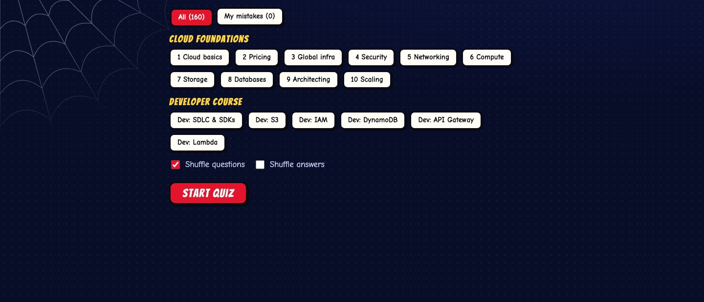

<div align="center">



# AWS Academy Quiz

**160 practice questions for the AWS Academy Cloud Foundations and Developer course knowledge checks, with instant feedback and a "My mistakes" mode.**

<p align="center">
  <a href="https://astmirzhan.github.io/aws-academy-quiz/"></a>
</p>

<p align="center">
  
  
  
  
</p>

</div>

---

A small, dependency-free quiz site for practicing AWS Academy knowledge checks before an exam.
Plain HTML, CSS and JavaScript with no build step. Works offline (only the fonts load from Google Fonts).

## Features

- 160 questions across two courses:
  - **Cloud Foundations** (modules 1-10): cloud basics, pricing, global infrastructure, security, networking and content delivery, compute, storage, databases, architecting, auto scaling and monitoring.
  - **Developer course**: SDLC and SDKs, S3, IAM, DynamoDB, API Gateway, Lambda and X-Ray.
- Single-answer and multi-answer ("Choose two/three") questions.
- Instant feedback: correct answers in green, mistakes in red, with a short explanation.
- Filter by module, or practice only the questions you got wrong ("My mistakes").
- Optional shuffling of questions and answers.
- Progress is saved in the browser (`localStorage`). Nothing is sent anywhere.
- Keyboard: `1`-`9` select an option, `Enter` checks / goes to the next question.
- Spider-Man inspired comic look: night-city palette, halftone dots, a web in the corner, POW/OOPS bursts, answer combos and a rank on the results screen. Animations respect `prefers-reduced-motion`.

## Project structure

```
index.html        markup
css/style.css     theme and layout
js/questions.js   module list (MODS) and the question bank (QUESTIONS)
js/app.js         quiz logic, progress storage, screens
```

## Run locally

Open `index.html` in a browser. That's it.

## Add or edit questions

Questions live in the `QUESTIONS` array in `js/questions.js`:

```js
{m:6, q:"Which service is serverless compute?", o:["EC2","Lambda","VPC"], a:[1], n:"Short explanation"}
```

- `m` module id (see the `MODS` list in the same file), `q` question, `o` options,
- `a` indexes of the correct options (more than one makes it a multi-select),
- `n` optional explanation.

## Disclaimer

This is an unofficial study aid. It is not affiliated with or endorsed by Amazon Web Services.
Correct answers were worked out from AWS knowledge, not taken from an official answer key, so a few
may be wrong. Questions with some doubt say so in their explanation. Always verify against the course material.
The visual style is an homage only: no Marvel logos, characters or artwork are used.
